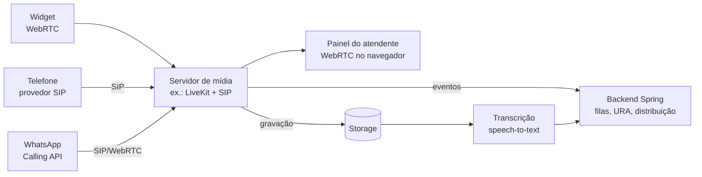

# Chat de Suporte — Plano do Front-end

> Arquitetura, stack e protótipos de tela do projeto front-end.
> Complementa o `chat-suporte-arquitetura.md` (visão geral e backend).
> Versão 0.2 · novembro de 2026 — inclui as decisões de produto da rodada de perguntas

---

## 1. Organização: dois projetos

| Projeto | Conteúdo | Linguagem |
|---|---|---|
| `chat-suporte-backend` | API REST + WebSocket (Spring Boot), migrações, jobs | Java 21+ |
| `chat-suporte-frontend` | Painel do atendente, painel admin e widget do cliente | TypeScript |

Os dois projetos se comunicam **só pelo contrato**: o OpenAPI da API REST e a lista de destinos STOMP do WebSocket (seção 6). Cada um tem repositório, pipeline e deploy próprios.

### Por que um único projeto de front (e não três)

As três interfaces dividem tipos, cliente da API, conexão WebSocket e componentes de chat. Num só projeto, isso fica em pastas compartilhadas, sem monorepo nem pacotes publicados.

A única peça diferente é o **widget**: ele roda no site de outra empresa e precisa ser pequeno. Por isso ele é um **segundo ponto de entrada no Vite**, com build próprio:

```
vite build             →  dist/app/        (atendente + admin, uma SPA)
vite build --mode widget →  dist/widget/    (loader.js + página do iframe)
```

Assim o widget não carrega o editor de fluxo, os gráficos do admin nem a lógica de login dos painéis.

**Quando separar em mais projetos:** se o widget passar a ter equipe ou ciclo de release próprio, ou se o bundle dele crescer demais por causa do código compartilhado.

### Decisões de produto

| Tema | Decisão |
|---|---|
| Dispositivos | Desktop e celular responsivo. No celular, lista, chat e contato viram telas separadas |
| Marca | Painéis com a marca da plataforma; só o widget é personalizado por empresa |
| Idiomas | Só pt-BR, com textos centralizados no react-i18next desde o início |
| Tema | Claro e escuro no MVP |
| Layout do console | Uma conversa aberta, com a lista ao lado |
| Produtividade | Respostas rápidas (`/atalho`), notas internas, anexos e colar imagem, busca no histórico |
| Painel do contato | Histórico de conversas, atributos do sistema da empresa, edição do contato e dados ao vivo via API da empresa |
| Supervisor | Ver ao vivo, sussurrar ao atendente, assumir e redistribuir em massa |
| **Regras de atendimento** | **Todas parametrizáveis por empresa, configuradas pela própria empresa** numa tela de regras (seção 8.2) |
| Permissões | Perfis customizáveis: o admin cria perfis marcando permissões |
| Integrações | Tela de integrações com URL, autenticação e mapeamento dos campos exibidos |
| Widget | Anexos e prints, emojis, transcrição por e-mail, aviso de nova mensagem |
| Teste de fluxo | Simulador dentro do editor |
| Relatórios | Exportar CSV/Excel, envio agendado por e-mail, abrir as conversas por trás de um número, relatório por pergunta da triagem |
| Onboarding | Assistente de configuração passo a passo |
| **Ligações (fase 2)** | Navegador (WebRTC), telefone comum e WhatsApp; cliente liga e recebe ligação; vídeo, compartilhamento de tela, gravação e transcrição; mesmas filas do chat, com URA (seção 11) |

---

## 2. Stack

| Camada | Escolha | Por quê |
|---|---|---|
| Linguagem | TypeScript (strict) | Tipos do contrato da API em todo o front |
| Build | Vite | Rápido e com suporte a múltiplos pontos de entrada |
| UI | React | — |
| Rotas | React Router | Rotas aninhadas, loaders e guards por papel |
| Dados do servidor | TanStack Query | Cache, refetch e atualização do cache por eventos do WebSocket |
| Estado local | Zustand | Presença do atendente, conversa aberta, rascunhos, conexão |
| Tempo real | `@stomp/stompjs` | Cliente STOMP com reconexão e heartbeat |
| Editor de fluxo | React Flow (`@xyflow/react`) | Nós e arestas customizáveis; o formato `nodes`/`edges` já é o salvo no backend |
| Componentes | shadcn/ui (Radix) + Tailwind CSS | Acessível, e o código dos componentes fica no projeto |
| Formulários | React Hook Form + Zod | Os mesmos schemas Zod validam formulários e respostas da API |
| Datas | date-fns (pt-BR) | Horários, prazos de SLA e "há 3 min" |
| Gráficos | Recharts | Relatórios do admin |
| Ícones | lucide-react | Padrão do shadcn |
| Idiomas | react-i18next | Só pt-BR agora; nenhum texto fixo nos componentes |
| Tema | CSS variables + classe `dark` do Tailwind | Segue o sistema operacional, com troca manual salva por usuário |
| Emojis | Seletor carregado sob demanda (lazy) | Não pesa no bundle inicial do widget nem do console |
| Upload | Envio direto ao storage por URL assinada, com barra de progresso | O arquivo não passa pelo backend |
| Testes | Vitest + Testing Library; Playwright (E2E) | — |
| Qualidade | ESLint + Prettier | — |

**Widget:** usa React, mas só com Tailwind e os componentes de chat. Nada de Radix pesado, React Flow ou Recharts. Meta de tamanho: **< 80 KB gzip** para a página do iframe e **< 5 KB** para o `loader.js`.

---

## 3. Contrato com o backend (sem mock)

Por enquanto não haverá dados falsos. O front nasce com **tipos e cliente da API escritos à mão**, seguindo o contrato planejado.

1. **Agora:** `src/shared/api/types.ts` com os tipos de domínio e `src/shared/api/client.ts` com uma função por endpoint (seção 6). As telas usam esses hooks e ficam em estado de carregamento ou erro até o backend responder.
2. **Quando o backend existir:** o Spring expõe o OpenAPI (springdoc). O front passa a **gerar** os tipos com `openapi-typescript` e usa `openapi-fetch` como cliente. Os tipos escritos à mão são substituídos e o compilador aponta cada divergência.

> Para isso funcionar, o contrato da seção 6 deve ser tratado como fonte da verdade dos dois lados até o OpenAPI existir.

---

## 4. Estrutura de pastas

Organização por **funcionalidade** (feature), não por tipo de arquivo.

```
chat-suporte-frontend/
├── index.html                     # SPA (atendente + admin)
├── widget.html                    # página carregada dentro do iframe
├── vite.config.ts                 # entradas: app e widget
├── src/
│   ├── app/                       # entrada da SPA
│   │   ├── main.tsx
│   │   ├── router.tsx
│   │   └── providers.tsx          # QueryClient, Auth, Realtime, Theme
│   │
│   ├── widget/                    # entrada do widget
│   │   ├── loader.ts              # script que o cliente cola no site (cria botão + iframe)
│   │   ├── main.tsx               # app dentro do iframe
│   │   ├── screens/               # Triagem, NaFila, EmAtendimento, Avaliacao, ForaHorario
│   │   └── bridge.ts              # postMessage entre site ↔ iframe (abrir, fechar, identify)
│   │
│   ├── features/
│   │   ├── auth/                  # login, refresh, guards por papel
│   │   ├── console/               # painel do atendente
│   │   │   ├── conversation-list/
│   │   │   ├── chat/
│   │   │   ├── contact-panel/
│   │   │   ├── transfer/
│   │   │   └── close/
│   │   ├── queue/                 # fila (assumir manualmente), posição
│   │   ├── supervisor/            # visão ao vivo de filas, atendentes, SLA
│   │   ├── presence/              # status online/pausa, heartbeat
│   │   └── admin/
│   │       ├── queues/
│   │       ├── flows/             # editor React Flow
│   │       │   ├── nodes/         # um componente por tipo de nó
│   │       │   ├── inspector/     # painel lateral de propriedades
│   │       │   └── validation.ts  # mesma validação do backend, para feedback imediato
│   │       ├── channels/
│   │       ├── business-hours/
│   │       ├── sla/
│   │       ├── users/
│   │       ├── tabulations/
│   │       └── reports/
│   │
│   ├── shared/
│   │   ├── api/                   # types.ts, client.ts, hooks de query/mutation
│   │   ├── realtime/              # cliente STOMP, assinaturas, sincronização com o cache
│   │   ├── chat-ui/               # bolhas, input, anexos, "digitando" (usado no console E no widget)
│   │   ├── ui/                    # componentes shadcn
│   │   ├── lib/                   # formatação de datas, máscaras CPF/CNPJ, cálculo de SLA restante
│   │   └── config.ts              # URLs da API e do WebSocket por ambiente
│   │
│   └── styles/
│       └── tokens.css             # cores, espaçamentos, tema claro/escuro
└── tests/
    └── e2e/
```

**Regra de dependência:** `widget/` só importa de `shared/chat-ui`, `shared/api` e `shared/realtime`. Nunca de `features/`. Uma regra de lint (`eslint-plugin-boundaries` ou `no-restricted-imports`) garante isso e protege o tamanho do bundle.

---

## 5. Rotas e permissões

| Rota | Tela | Permissão necessária |
|---|---|---|
| `/login` | Login | público |
| `/onboarding` | Assistente de configuração | `config.gerenciar` (só enquanto a empresa não concluiu) |
| `/app` | Console de atendimento | `conversa.atender` |
| `/app/conversas/:id` | Console com a conversa aberta | `conversa.atender` ou `supervisao.ver` |
| `/app/fila` | Filas (assumir manualmente) | `fila.puxar` |
| `/app/busca` | Busca no histórico | `historico.buscar` |
| `/app/supervisor` | Visão ao vivo | `supervisao.ver` |
| `/admin/relatorios` | Relatórios | `relatorio.ver` |
| `/admin/filas`, `/admin/filas/:id` | Filas | `fila.gerenciar` |
| `/admin/fluxos`, `/admin/fluxos/:id` | Lista e editor de fluxo | `fluxo.editar` |
| `/admin/canais`, `/admin/canais/:id` | Canais e instalação do widget | `canal.gerenciar` |
| `/admin/regras` | Regras de atendimento | `regra.gerenciar` |
| `/admin/respostas-rapidas` | Respostas rápidas da empresa | `resposta.gerenciar` |
| `/admin/integracoes`, `/admin/integracoes/:id` | Integrações com a API da empresa | `integracao.gerenciar` |
| `/admin/horarios` | Horários de atendimento | `horario.gerenciar` |
| `/admin/sla` | Políticas de SLA | `sla.gerenciar` |
| `/admin/usuarios` | Usuários | `usuario.gerenciar` |
| `/admin/perfis`, `/admin/perfis/:id` | Perfis e permissões | `perfil.gerenciar` |
| `/admin/tabulacoes` | Tabulações e pesquisa de satisfação | `tabulacao.gerenciar` |

O guard confere as permissões do usuário e esconde do menu o que ele não pode acessar. Quem abre uma rota sem permissão vai para a primeira tela que pode usar. **O backend valida de novo**; o guard só evita mostrar telas inúteis.

### Perfis e permissões

Os papéis fixos viram **perfis customizáveis**. Toda empresa nasce com três perfis padrão (Administrador, Supervisor, Atendente), que podem ser editados, e cria quantos outros quiser.

| Grupo | Permissões |
|---|---|
| Atendimento | `conversa.atender`, `fila.puxar`, `conversa.transferir`, `conversa.encerrar`, `contato.editar`, `historico.buscar` |
| Supervisão | `supervisao.ver`, `supervisao.sussurrar`, `supervisao.assumir`, `supervisao.redistribuir`, `conversa.prioridade` |
| Configuração | `fila.gerenciar`, `fluxo.editar`, `fluxo.publicar`, `canal.gerenciar`, `regra.gerenciar`, `resposta.gerenciar`, `integracao.gerenciar`, `horario.gerenciar`, `sla.gerenciar`, `tabulacao.gerenciar` |
| Administração | `usuario.gerenciar`, `perfil.gerenciar`, `config.gerenciar` |
| Relatórios | `relatorio.ver`, `relatorio.exportar`, `relatorio.agendar` |

As permissões de supervisão têm **escopo**: "todas as filas" ou "só as filas que supervisiona". O escopo é definido no usuário, não no perfil, para que dois supervisores com o mesmo perfil cuidem de filas diferentes.

### Autenticação no front

- **Access token** em memória (variável no store, nunca `localStorage`).
- **Refresh token** em cookie `httpOnly` + `Secure` + `SameSite`, renovado em `/auth/refresh`.
- Ao recarregar a página, o app chama `/auth/refresh` antes de renderizar as rotas protegidas.
- O token do WebSocket vai no header `Authorization` do frame `CONNECT` do STOMP.
- O JWT leva só o `perfilId`. A lista de permissões vem de `/me` e é recarregada quando o admin altera o perfil (evento `perfil.atualizado` no WebSocket), sem precisar sair e entrar de novo.

---

## 6. Contrato planejado

### 6.1 Tipos de domínio (TypeScript)

```ts
export type Permission =
  | 'conversa.atender' | 'fila.puxar' | 'conversa.transferir' | 'conversa.encerrar'
  | 'contato.editar' | 'historico.buscar'
  | 'supervisao.ver' | 'supervisao.sussurrar' | 'supervisao.assumir'
  | 'supervisao.redistribuir' | 'conversa.prioridade'
  | 'fila.gerenciar' | 'fluxo.editar' | 'fluxo.publicar' | 'canal.gerenciar'
  | 'regra.gerenciar' | 'resposta.gerenciar' | 'integracao.gerenciar'
  | 'horario.gerenciar' | 'sla.gerenciar' | 'tabulacao.gerenciar'
  | 'usuario.gerenciar' | 'perfil.gerenciar' | 'config.gerenciar'
  | 'relatorio.ver' | 'relatorio.exportar' | 'relatorio.agendar';

export interface Profile {
  id: string;
  nome: string;
  padrao: boolean;                 // um dos três perfis criados com a empresa
  permissoes: Permission[];
}

export interface Me {
  id: string;
  nome: string;
  perfil: Profile;
  escopoSupervisao: 'TODAS' | { filaIds: string[] };
  filas: { id: string; nome: string }[];
  preferencias: { tema: 'SISTEMA' | 'CLARO' | 'ESCURO'; som: boolean; notificacoes: boolean };
}

export type Priority = 'BAIXA' | 'NORMAL' | 'ALTA' | 'URGENTE';
export type ConversationStatus =
  | 'TRIAGEM' | 'NA_FILA' | 'EM_ATENDIMENTO' | 'AGUARDANDO_CLIENTE'
  | 'ENCERRADA' | 'ABANDONADA' | 'FORA_HORARIO';
export type DistributionStrategy = 'SKILL' | 'ROUND_ROBIN' | 'LEAST_BUSY' | 'MANUAL_PULL';
export type AgentStatus = 'ONLINE' | 'PAUSA' | 'OFFLINE';

export interface Contact {
  id: string;
  nome: string | null;
  email: string | null;
  telefone: string | null;
  documento: string | null;
  idExterno: string | null;
  atributos: Record<string, string>;
}

export interface Conversation {
  id: string;
  status: ConversationStatus;
  prioridade: Priority;
  contato: Contact;
  canal: { id: string; tipo: 'WIDGET' | 'EMBED' | 'WHATSAPP'; nome: string };
  fila: { id: string; nome: string } | null;
  atendente: { id: string; nome: string } | null;
  entrouFilaEm: string | null;          // ISO 8601
  atribuidaEm: string | null;
  slaPrimeiraRespostaAte: string | null;
  slaResolucaoAte: string | null;
  naoLidas: number;
  ultimaMensagem: Pick<Message, 'conteudo' | 'autorTipo' | 'criadoEm'> | null;
  respostasTriagem: { pergunta: string; resposta: string }[];
}

export interface Message {
  id: string;
  conversationId: string;
  autorTipo: 'CONTATO' | 'AGENTE' | 'SISTEMA' | 'BOT';
  autor: { id: string; nome: string } | null;
  tipo: 'TEXTO' | 'IMAGEM' | 'ARQUIVO' | 'OPCOES' | 'EVENTO' | 'NOTA_INTERNA';
  conteudo: string;
  opcoes?: { id: string; label: string }[];   // perguntas da triagem
  anexo?: { url: string; nome: string; tamanho: number; mime: string };
  criadoEm: string;
  entregueEm: string | null;
  lidaEm: string | null;
  clientId?: string;                          // id temporário para envio otimista
}

export interface Queue {
  id: string;
  nome: string;
  estrategia: DistributionStrategy;
  businessHoursId: string | null;
  slaPolicyId: string | null;
  prioridadePadrao: Priority;
  membros: { userId: string; nome: string; nivel: number }[];
  mensagemForaHorario: string;
  ativo: boolean;
}

export interface QueueStats {
  queueId: string;
  aguardando: number;
  emAtendimento: number;
  maiorEsperaSeg: number;
  atendentesOnline: number;
  slaEmRisco: number;
}

export interface Agent {
  id: string;
  nome: string;
  status: AgentStatus;
  motivoPausa: string | null;
  atendimentosAtivos: number;
  capacidadeMax: number;
}

/** Regras parametrizáveis pela própria empresa (tela /admin/regras). */
export interface ServiceRules {
  assumir: {
    somenteFilasSupervisionadas: boolean;
    motivoObrigatorio: boolean;
    motivos: string[];                       // lista sugerida; "Outro" sempre disponível
    avisarAtendente: boolean;
    contaNaCapacidadeDoSupervisor: boolean;
  };
  redistribuir: {
    modoPadrao: 'POSICAO_ORIGINAL' | 'DISTRIBUIR_AGORA' | 'SUPERVISOR_ESCOLHE';
    modosPermitidos: ('POSICAO_ORIGINAL' | 'DISTRIBUIR_AGORA' | 'SUPERVISOR_ESCOLHE')[];
    manterAguardandoClienteSeEmPausa: boolean;
    motivoObrigatorio: boolean;
  };
  atendenteDesconectado: {
    acao: 'SUPERVISOR_DECIDE' | 'VOLTAR_PARA_FILA';
    aposMinutos: number;
  };
  transferencia: {
    notaObrigatoria: boolean;
    manterHoraEntradaNaFila: boolean;
  };
  encerramento: {
    tabulacaoObrigatoria: boolean;
    inatividadeAvisoMin: number;
    inatividadeEncerrarMin: number;
    enviarPesquisa: boolean;
    permitirTranscricaoEmail: boolean;
  };
  atendimento: {
    clienteVeNomeDoAtendente: boolean;
    clientePodeEscreverNaFila: boolean;
    notificarSupervisorSlaPercentual: number;
  };
}

export interface Integration {
  id: string;
  nome: string;
  metodo: 'GET' | 'POST';
  url: string;                               // aceita {idExterno}, {documento}, {email}, {telefone}
  autenticacao: { tipo: 'NENHUMA' | 'BEARER' | 'BASIC' | 'HEADER'; headerNome?: string };
  // o segredo nunca volta para o front; só "configurado: true"
  segredoConfigurado: boolean;
  timeoutMs: number;
  cacheSeg: number;
  campos: {
    caminho: string;                         // JSONPath na resposta, ex.: $.financeiro.situacao
    rotulo: string;
    formato: 'TEXTO' | 'MOEDA' | 'DATA' | 'NUMERO' | 'ETIQUETA' | 'LINK';
    destaque?: { quandoIgual: string; cor: 'VERDE' | 'AMARELO' | 'VERMELHO' };
  }[];
  canalIds: string[];                        // em quais canais a integração aparece
}

export interface QuickReply {
  id: string;
  atalho: string;                            // "/boasvindas"
  titulo: string;
  conteudo: string;                          // aceita {contato.nome}, {atendente.nome}, {empresa}
  escopo: 'EMPRESA' | 'PESSOAL';
  filaIds: string[] | null;                  // null = todas
}

export interface FlowVersion {
  id: string;
  flowId: string;
  numero: number;
  status: 'RASCUNHO' | 'PUBLICADO' | 'ARQUIVADO';
  definicao: { nodes: FlowNode[]; edges: FlowEdge[] };
  publicadoEm: string | null;
}
```

### 6.2 Endpoints REST

| Método | Caminho | Uso |
|---|---|---|
| POST | `/auth/login` · `/auth/refresh` · `/auth/logout` | Sessão |
| GET | `/me` | Usuário logado, papel, filas |
| PUT | `/me/status` | Online / pausa (com motivo) |
| GET | `/conversations?status=&queueId=&agentId=&cursor=` | Lista paginada por cursor |
| GET | `/conversations/:id` | Detalhe |
| GET | `/conversations/:id/messages?before=&limit=` | Histórico (rolar para cima) |
| POST | `/conversations/:id/messages` | Enviar mensagem ou nota interna |
| POST | `/conversations/:id/assign` | Assumir (fila manual) |
| POST | `/conversations/:id/transfer` | `{ queueId \| agentId, nota }` |
| POST | `/conversations/:id/close` | `{ tabulacaoId, observacao }` |
| PATCH | `/conversations/:id` | Prioridade, atributos |
| GET | `/queues` · `/queues/stats` | Filas e números ao vivo |
| GET/POST/PUT/DELETE | `/admin/queues`, `/admin/flows`, `/admin/channels`, `/admin/business-hours`, `/admin/sla-policies`, `/admin/users`, `/admin/tabulations` | CRUD do admin |
| POST | `/admin/flows/:id/versions` | Salvar rascunho |
| POST | `/admin/flows/:id/versions/:v/publish` | Publicar (retorna erros de validação, se houver) |
| GET | `/admin/reports/summary?from=&to=&queueId=` | TME, TMA, abandono, SLA, CSAT |
| POST | `/attachments` | Gera URL assinada para upload |
| POST | `/conversations/:id/whisper` | Sussurro do supervisor (nota visível só ao atendente) |
| POST | `/conversations/:id/take-over` | Supervisor assume `{ motivo }` |
| POST | `/agents/:id/redistribute` | `{ modo, conversaIds?, destino?, motivo }` |
| GET | `/search?q=&contato=&documento=&from=&to=&queueId=` | Busca no histórico |
| PATCH | `/contacts/:id` | Edição do contato |
| GET | `/contacts/:id/live-data` | Dados ao vivo das integrações do canal (o backend chama a API da empresa) |
| GET/POST/PUT/DELETE | `/quick-replies` | Respostas rápidas pessoais e da empresa |
| GET/PUT | `/admin/rules` | Regras de atendimento da empresa |
| GET/POST/PUT/DELETE | `/admin/profiles` | Perfis e permissões |
| GET/POST/PUT/DELETE | `/admin/integrations` | Integrações |
| POST | `/admin/integrations/:id/test` | `{ contatoExemplo }` → resposta crua + campos mapeados |
| GET | `/admin/reports/export?tipo=&formato=csv\|xlsx&...` | Exportação |
| GET/POST/DELETE | `/admin/reports/schedules` | Envios agendados por e-mail |
| GET | `/admin/reports/triage-funnel?flowId=&from=&to=` | Escolhas e abandonos por nó da triagem |
| GET/PUT | `/onboarding` | Passo atual do assistente e dados salvos |
| POST | `/onboarding/complete` | Conclui o assistente |

**Widget (rotas públicas, autenticadas pela `channel_key`):**

| Método | Caminho | Uso |
|---|---|---|
| POST | `/widget/session` | `{ channelKey, identityToken? }` → token da sessão do cliente + conversa aberta, se houver |
| GET | `/widget/config` | Cores, textos, horário, logo |
| POST | `/widget/conversations` | Iniciar conversa (dispara a triagem) |
| POST | `/widget/conversations/:id/messages` | Mensagem ou resposta de opção `{ optionId }` |
| POST | `/widget/conversations/:id/rating` | CSAT/NPS |
| POST | `/widget/attachments` | URL assinada para upload do cliente (tipos e tamanho limitados pelo canal) |
| POST | `/widget/conversations/:id/transcript` | `{ email }` → envia a transcrição |

### 6.3 Eventos do WebSocket (STOMP)

| Destino | Evento | Efeito no front |
|---|---|---|
| `/topic/t.{tenant}.conv.{id}` | `message.created`, `message.read`, `typing`, `conversation.updated` | Adiciona no cache de mensagens; atualiza status e prioridade |
| `/user/queue/assignments` | `conversation.assigned` | Entra na lista do atendente + som/notificação do navegador |
| `/topic/t.{tenant}.queue.{id}` | `queue.changed` | Atualiza `QueueStats` e a lista da fila manual |
| `/topic/t.{tenant}.supervisor` | `sla.warning`, `sla.breached`, `agent.status` | Alertas e grade de atendentes |
| `/user/queue/notices` | `conversation.taken_over`, `conversations.redistributed`, `whisper.created`, `perfil.atualizado` | Avisos ao atendente; recarregar permissões |
| `/user/queue/widget` (sessão do cliente) | `queue.position`, `message.created`, `conversation.closed` | Telas do widget |

**Sincronização:** cada evento atualiza o cache do TanStack Query com `queryClient.setQueryData`, sem refetch. Na reconexão, o front refaz as queries ativas e pede mensagens posteriores ao último `id` conhecido de cada conversa aberta.

**Envio otimista:** a mensagem aparece na hora com `clientId` e status "enviando". Quando o `message.created` chega com o mesmo `clientId`, ela é substituída pela versão do servidor. Se der erro, aparece "Falhou · tentar de novo".

---

## 7. Diretrizes visuais

### 7.1 Tokens

| Token | Uso |
|---|---|
| `--priority-urgente` (vermelho) · `--priority-alta` (laranja) · `--priority-normal` (neutro) · `--priority-baixa` (cinza) | Etiqueta de prioridade |
| `--sla-ok` (verde) · `--sla-risco` (âmbar, > 75% do prazo) · `--sla-estourado` (vermelho) | Indicador de SLA na lista |
| `--status-online` · `--status-pausa` · `--status-offline` | Bolinha de presença |
| `--bubble-contact` · `--bubble-agent` · `--bubble-internal` (amarelo claro) · `--bubble-system` | Bolhas de mensagem |

| `--bubble-whisper` (roxo claro) | Sussurro do supervisor |

Cor nunca é o único sinal. Prioridade e SLA também têm texto ou ícone, para acessibilidade e daltonismo.

**Tema claro e escuro:** todos os tokens existem nas duas versões, e nenhum componente usa cor fixa. Os contrastes AA são conferidos nos dois temas. O widget segue o tema do site do cliente (configurável: claro, escuro ou automático).

**Marca:** os painéis usam sempre a identidade da plataforma. A empresa cliente aparece só como nome e logo pequeno no topo do menu, para o atendente saber em qual empresa está logado.

### 7.2 Tema do widget

O admin define a cor primária, o logo, o nome exibido, a posição (canto direito ou esquerdo) e os textos. O widget aplica tudo via CSS variables vindas de `/widget/config`.

### 7.3 Acessibilidade

- Navegação completa por teclado no console (atalhos na seção 8.1).
- Novas mensagens anunciadas por `aria-live="polite"`.
- Contraste mínimo AA.
- Componentes Radix já tratam foco, modais e menus.

---

## 8. Protótipos de tela

> Wireframes de baixa fidelidade. Servem para estabelecer layout e conteúdo, não o visual final.

### 8.1 Painel do atendente

#### Login

```
┌─────────────────────────────────────────┐
│                                         │
│              [ logo ]                   │
│        Entrar no atendimento            │
│                                         │
│   E-mail                                │
│   ┌─────────────────────────────────┐   │
│   │ lucas@empresa.com               │   │
│   └─────────────────────────────────┘   │
│   Senha                                 │
│   ┌─────────────────────────────────┐   │
│   │ ••••••••                        │   │
│   └─────────────────────────────────┘   │
│                                         │
│   [          Entrar          ]          │
│            Esqueci a senha              │
└─────────────────────────────────────────┘
```

Se o e-mail existir em mais de uma empresa, aparece um passo extra: "Escolha a empresa".

#### Console de atendimento (tela principal)

```
┌────┬──────────────────────────────────────────────────────────────────────────────────────────┐
│ ☰  │ Atendimento        Fila Suporte: 4 aguardando · maior espera 06:12       ● Online ▾  (LD)│
├────┼──────────────────────┬────────────────────────────────────────────┬──────────────────────┤
│ 💬 │ 🔍 Buscar            │ Mercado Bom Preço · João Silva       ⋯     │ CONTATO              │
│    │ [Meus 3] [Fila 4]    │ Suporte técnico · ALTA · SLA 04:30 ⚠       │ João Silva           │
│ ⏳ │──────────────────────│ [Transferir] [Prioridade ▾] [Encerrar]     │ joao@bompreco.com    │
│    │▌João Silva    ⚠04:30 │────────────────────────────────────────────│ (46) 99999-0000      │
│ 📊 │ Mercado Bom Preço    │      ── Triagem ──                         │ CNPJ 12.345.678/0001 │
│    │ "A NF não sai..."  2 │ BOT  Sobre o que você quer falar?          │ ID externo: C-1042   │
│ ⚙  │ ALTA · Suporte       │ JOÃO Suporte técnico                       │──────────────────────│
│    │──────────────────────│ BOT  Qual o seu CNPJ?                      │ TRIAGEM              │
│    │ Maria Souza   ✓12:00 │ JOÃO 12.345.678/0001-90                    │ Assunto: Suporte téc.│
│    │ Loja Centro          │      ── Atribuída a você · 20:41 ──        │ Módulo: Fiscal       │
│    │ "Obrigada!"          │                                            │──────────────────────│
│    │ NORMAL · Financeiro  │ JOÃO  A nota fiscal não está saindo,       │ HISTÓRICO            │
│    │──────────────────────│       dá erro de rejeição 539.     20:42   │ 05/11 · Financeiro   │
│    │ Pedro Lima    ⏸      │                                            │   Encerrada · CSAT 5 │
│    │ Aguardando cliente   │           Oi João! Vou verificar.  20:43 ✓✓│ 28/10 · Suporte      │
│    │ NORMAL · Suporte     │                                            │   Encerrada · CSAT 4 │
│    │                      │ 📝 Nota interna (só equipe):               │──────────────────────│
│    │                      │    Cliente já teve esse erro em out.       │ ATRIBUTOS            │
│    │                      │                                            │ Plano: Premium       │
│    │                      │ João está digitando...                     │                      │
│    │                      │────────────────────────────────────────────│                      │
│    │                      │ [Mensagem | Nota interna]                  │                      │
│    │                      │ ┌────────────────────────────────────────┐ │                      │
│    │                      │ │ Digite /  para respostas rápidas       │ │                      │
│    │                      │ └────────────────────────────────────────┘ │                      │
│    │                      │ 📎  😊                        [ Enviar ⏎ ] │                      │
└────┴──────────────────────┴────────────────────────────────────────────┴──────────────────────┘
```

- **Coluna 1, lista de conversas:** abas "Meus" (atribuídas a mim) e "Fila" (se houver fila manual). Ordenação por SLA mais crítico. Cada item mostra nome, empresa, prévia, não lidas, prioridade, fila e indicador de SLA.
- **Coluna 2, chat:** cabeçalho com ações, respostas da triagem no topo, notas internas com fundo diferente, alternância Mensagem / Nota interna.
- **Coluna 3, contato:** dados, respostas da triagem, conversas anteriores e atributos vindos do sistema da empresa. Pode ser recolhida.
- **Barra superior:** resumo das filas do atendente e seletor de status.

Atalhos: `Alt+↑/↓` troca de conversa · `Ctrl+Enter` envia · `Ctrl+Shift+N` alterna nota interna · `Ctrl+Shift+T` transferir · `Ctrl+Shift+E` encerrar · `Ctrl+K` busca no histórico.

- **Anexos:** botão 📎, arrastar e soltar no chat, ou `Ctrl+V` com um print copiado. Abre uma prévia com campo de legenda antes de enviar.
- **Sussurro do supervisor:** aparece no chat com fundo roxo e o rótulo "🔒 Paula (supervisora) · só você vê".

Responsividade: entre 768 e 1280 px, a coluna 3 vira gaveta. Abaixo de 768 px, lista, chat e contato viram telas separadas (seção 8.1, "Celular").

#### Respostas rápidas

Ao digitar `/` no campo de mensagem:

```
│ ┌──────────────────────────────────────────────┐ │
│ │ /boasvindas   Boas-vindas            Empresa │ │
│ │ /nfe539       Rejeição 539 — CFOP    Empresa │ │
│ │ /aguarde      Pedir para aguardar    Pessoal │ │
│ │ ─────────────────────────────────────────────│ │
│ │ Olá {contato.nome}! Sou {atendente.nome} e   │ │
│ │ vou te ajudar hoje.                 (prévia) │ │
│ └──────────────────────────────────────────────┘ │
│ ┌──────────────────────────────────────────────┐ │
│ │ /bo█                                         │ │
│ └──────────────────────────────────────────────┘ │
```

`↑/↓` escolhe, `Enter` insere o texto com as variáveis preenchidas, e o atendente ainda pode editar antes de enviar. As pessoais são criadas pelo próprio atendente (menu do perfil → Respostas rápidas); as da empresa, no admin.

#### Painel do contato com dados ao vivo

```
┌──────────────────────┐
│ CONTATO      [Editar]│
│ João Silva           │
│ joao@bompreco.com    │
│ (46) 99999-0000      │
│ CNPJ 12.345.678/0001 │
│──────────────────────│
│ ERP DA EMPRESA   ⟳   │
│ atualizado há 1 min  │
│ Situação  🟢 Em dia   │
│ Plano     Premium    │
│ Versão    5.12.3     │
│ Último pedido        │
│   08/11 · R$ 1.240,00│
│ [Abrir no ERP ↗]     │
│──────────────────────│
│ TRIAGEM              │
│ Assunto: Suporte téc.│
│──────────────────────│
│ HISTÓRICO        (4) │
│ 05/11 Financeiro ★5  │
│ 28/10 Suporte    ★4  │
│ Ver todos ▸          │
└──────────────────────┘
```

- **Editar** abre os campos inline (permissão `contato.editar`).
- O bloco "ERP da empresa" vem da integração do canal. Ele carrega separado do resto, para não atrasar a abertura da conversa: mostra skeleton enquanto carrega e, se a API da empresa falhar ou demorar, exibe "Não foi possível consultar · tentar de novo" sem afetar o chat.
- A chamada à API da empresa **sempre passa pelo backend**. O segredo de autenticação nunca chega ao navegador, e não há problema de CORS com a API do cliente.

#### Busca no histórico

```
┌──────────────────────────────────────────────────────────────────────────────┐
│ 🔍 rejeição 539                    [Período ▾] [Fila ▾] [Atendente ▾]        │
├──────────────────────────────────────────────────────────────────────────────┤
│ 23 resultados                                                                │
│                                                                              │
│ João Silva · Mercado Bom Preço         05/11 · Suporte · Lucas D. · ★5       │
│   "...a nota está dando **rejeição 539** desde ontem..."                      │
│                                                                              │
│ Carla Mendes · Auto Peças Sul          21/10 · Fiscal · Marcos R. · ★4       │
│   "...corrigi o CFOP e a **rejeição 539** sumiu..."                           │
└──────────────────────────────────────────────────────────────────────────────┘
```

Busca por nome, CNPJ/CPF, e-mail, telefone ou texto das mensagens. O resultado abre a conversa em modo leitura, com o trecho destacado.

#### Seletor de status

```
┌──────────────────────────┐
│ ● Online                 │
│ ◐ Pausa ▸ ┌────────────┐ │
│ ○ Offline │ Almoço     │ │
│           │ Reunião    │ │
│           │ Treinamento│ │
│           │ Outro...   │ │
│           └────────────┘ │
│ Capacidade: 3 / 5        │
└──────────────────────────┘
```

#### Fila (assumir manualmente)

```
┌──────────────────────────────────────────────────────────────────────────────┐
│ Filas            [Suporte técnico ▾]                         4 aguardando    │
├────┬───────────────────────┬────────────┬──────────┬─────────────┬───────────┤
│ #  │ Contato               │ Prioridade │ Espera   │ SLA         │           │
├────┼───────────────────────┼────────────┼──────────┼─────────────┼───────────┤
│ 1  │ Ana Costa · Farmácia X│ URGENTE    │ 06:12    │ ⛔ estourado │ [Assumir] │
│ 2  │ Carlos · Auto Peças   │ ALTA       │ 04:01    │ ⚠ 00:59     │ [Assumir] │
│ 3  │ Bruna · Padaria Sol   │ NORMAL     │ 02:30    │ ✓ 12:30     │ [Assumir] │
│ 4  │ (anônimo)             │ NORMAL     │ 00:45    │ ✓ 14:15     │ [Assumir] │
└────┴───────────────────────┴────────────┴──────────┴─────────────┴───────────┘
  Clicar na linha mostra a prévia da triagem sem assumir.
```

Se outro atendente assumir primeiro, a linha some e aparece o aviso "Ana Costa foi assumida por Marcos".

#### Modal de transferência

```
┌──────────────────────────────────────────┐
│ Transferir conversa                    ✕ │
│                                          │
│ ( ) Para uma fila   (•) Para um atendente│
│                                          │
│ 🔍 Buscar atendente                      │
│ ┌──────────────────────────────────────┐ │
│ │ ● Marcos Rocha    Fiscal     2/5     │ │
│ │ ● Paula Dias      Fiscal     4/5     │ │
│ │ ◐ Rafael Melo     Suporte    pausa   │ │
│ └──────────────────────────────────────┘ │
│                                          │
│ Nota para quem vai receber *             │
│ ┌──────────────────────────────────────┐ │
│ │ Rejeição 539, já conferi o CFOP.     │ │
│ └──────────────────────────────────────┘ │
│                                          │
│                [Cancelar] [Transferir]   │
└──────────────────────────────────────────┘
```

#### Modal de encerramento

```
┌──────────────────────────────────────────┐
│ Encerrar atendimento                   ✕ │
│                                          │
│ Motivo (tabulação) *                     │
│ ┌──────────────────────────────────────┐ │
│ │ Dúvida resolvida                   ▾ │ │
│ └──────────────────────────────────────┘ │
│ Observação                               │
│ ┌──────────────────────────────────────┐ │
│ │                                      │ │
│ └──────────────────────────────────────┘ │
│ [✓] Enviar pesquisa de satisfação        │
│                                          │
│                 [Cancelar] [Encerrar]    │
└──────────────────────────────────────────┘
```

#### Visão do supervisor

```
┌──────────────────────────────────────────────────────────────────────────────────────┐
│ Supervisão ao vivo                                           Hoje · atualizado agora │
├──────────────────┬──────────────────┬──────────────────┬─────────────────────────────┤
│ Aguardando   9   │ Em atendimento 14│ Maior espera     │ SLA cumprido hoje           │
│ ▲ 3 na última h  │ 6 atendentes     │ 08:40 (Fiscal)   │ 91%                         │
├──────────────────┴──────────────────┴──────────────────┴─────────────────────────────┤
│ FILAS                                                                                │
│ Fila          Estratégia    Aguard.  Em atend.  Maior espera  Online   SLA em risco  │
│ Suporte       Menor carga     4        8          06:12        3/4        2  ⚠        │
│ Fiscal        Por setor       5        4          08:40        2/3        3  ⛔       │
│ Financeiro    Rodízio         0        2          —            1/2        0           │
├──────────────────────────────────────────────────────────────────────────────────────┤
│ ATENDENTES                                         │ ALERTAS                         │
│ ● Lucas D.     Suporte   3/5   TMA 07:20           │ ⛔ 20:51 SLA estourado          │
│ ● Marcos R.    Fiscal    2/5   TMA 09:05           │    Ana Costa · Fiscal [Abrir]   │
│ ◐ Rafael M.    Suporte   pausa Almoço · 18 min     │ ⚠ 20:49 SLA em 75%              │
│ ○ Paula D.     Fiscal    offline                   │    Carlos · Suporte [Abrir]     │
│   [clique: ver conversas · redistribuir]           │                                 │
└──────────────────────────────────────────────────────────────────────────────────────┘
```

O supervisor abre qualquer conversa das filas que supervisiona em modo leitura. Ali ele pode sussurrar, assumir, transferir ou mudar a prioridade, de acordo com as permissões do perfil dele.

#### Conversa em modo supervisão

```
┌────────────────────────────────────────────────────────────┐
│ 👁 Supervisionando · atendente: Lucas D.                    │
│ [Sussurrar] [Assumir] [Transferir] [Prioridade ▾]          │
│────────────────────────────────────────────────────────────│
│ JOÃO  A nota fiscal não está saindo...               20:42 │
│                  Oi João! Vou verificar. (Lucas)     20:43 │
│ 🔒 Você → Lucas: confere o CFOP do item 3            20:44 │
│────────────────────────────────────────────────────────────│
│ 🔒 Sussurro para Lucas (o cliente não vê)                   │
│ ┌────────────────────────────────────────────────────────┐ │
│ │                                                        │ │
│ └────────────────────────────────────────────────────────┘ │
└────────────────────────────────────────────────────────────┘
```

No modo supervisão, o campo de mensagem envia **só sussurros**. Para falar com o cliente, o supervisor precisa assumir a conversa.

#### Modal "Assumir conversa"

```
┌──────────────────────────────────────────┐
│ Assumir conversa de Lucas D.           ✕ │
│                                          │
│ Motivo *                                 │
│ ┌──────────────────────────────────────┐ │
│ │ Cliente pediu um supervisor        ▾ │ │
│ └──────────────────────────────────────┘ │
│   SLA estourado                          │
│   Atendimento travado                    │
│   Outro...                               │
│                                          │
│ ℹ Lucas será avisado. O cliente verá     │
│   "Paula entrou na conversa".            │
│                                          │
│                  [Cancelar] [Assumir]    │
└──────────────────────────────────────────┘
```

Os campos e avisos seguem as **regras de atendimento da empresa**: o motivo só é obrigatório e o aviso ao atendente só aparece se estiverem ligados lá. Se a empresa limitar o supervisor às filas que supervisiona, o botão "Assumir" nem aparece nas outras filas.

#### Modal "Redistribuir conversas"

Aberto pela grade de atendentes da visão do supervisor.

```
┌──────────────────────────────────────────────────────────────┐
│ Redistribuir conversas de Rafael M.  (◐ pausa · 18 min)    ✕ │
│                                                              │
│ Conversas                                                    │
│ [✓] João Silva       Suporte   EM_ATENDIMENTO     ALTA       │
│ [✓] Ana Costa        Suporte   EM_ATENDIMENTO     NORMAL     │
│ [ ] Pedro Lima       Suporte   AGUARDANDO_CLIENTE NORMAL     │
│     ↳ fica com Rafael (regra: manter "aguardando cliente")   │
│                                                              │
│ Para onde?                                                   │
│ (•) Voltar para a fila na posição original                   │
│ ( ) Distribuir agora pela estratégia de cada fila            │
│ ( ) Escolher destino:  [Atendente ou fila ▾]                 │
│                                                              │
│ Motivo *  [Atendente saiu mais cedo                      ▾]  │
│                                                              │
│                         [Cancelar] [Redistribuir 2 conversas]│
└──────────────────────────────────────────────────────────────┘
```

- A opção pré-selecionada é o modo padrão definido nas regras, e só aparecem os modos que a empresa permitiu.
- As conversas "aguardando cliente" vêm desmarcadas quando a regra de mantê-las está ligada, mas o supervisor pode marcá-las.
- Ao confirmar, o atendente recebe o aviso "2 conversas foram redistribuídas por Paula" e os clientes recebem a mensagem de troca de atendente.

#### Celular (atendente)

```
┌────────────────────┐   ┌────────────────────┐   ┌────────────────────┐
│ ☰ Atendimento  ●▾  │   │ ← João Silva    ⋯  │   │ ← Contato          │
│ [Meus 3] [Fila 4]  │   │ ALTA · SLA 04:30 ⚠ │   │ João Silva         │
│────────────────────│   │────────────────────│   │ joao@bompreco.com  │
│▌João Silva  ⚠04:30 │   │ JOÃO A nota não    │   │ CNPJ 12.345.678/.. │
│ "A NF não sai.." 2 │   │      sai...  20:42 │   │────────────────────│
│────────────────────│   │                    │   │ ERP DA EMPRESA     │
│ Maria Souza ✓12:00 │   │   Oi João! 20:43 ✓✓│   │ Situação 🟢 Em dia │
│ "Obrigada!"        │   │                    │   │ Plano    Premium   │
│────────────────────│   │                    │   │────────────────────│
│ Pedro Lima  ⏸      │   │────────────────────│   │ HISTÓRICO (4)      │
│ Aguardando cliente │   │ 📎 Mensagem...  [➤]│   │ 05/11 Financeiro ★5│
│                    │   │                    │   │                    │
│ [💬] [⏳] [🔍] [👤] │   │                    │   │                    │
└────────────────────┘   └────────────────────┘   └────────────────────┘
      Lista                     Chat               Contato (toque no nome)
```

- Navegação inferior: Conversas, Fila, Busca, Perfil/status.
- Ações da conversa (transferir, encerrar, prioridade) ficam no menu `⋯`, em uma folha que sobe da parte de baixo da tela.
- A visão do supervisor no celular mostra só os cartões de números e os alertas. A grade completa é desktop.
- Os painéis admin funcionam no celular para consultas rápidas, mas o **editor de fluxo é só desktop**: no celular, aparece "Abra no computador para editar" com uma visualização somente leitura.

### 8.2 Painel admin

#### Layout geral

```
┌──────────────────┬───────────────────────────────────────────────────────┐
│ [logo] Empresa X │  Título da página                       [Ação ▸]     │
│                  ├───────────────────────────────────────────────────────┤
│ 📊 Relatórios    │                                                       │
│ 🗂 Filas          │                  conteúdo                             │
│ 🔀 Fluxos         │                                                       │
│ 🔌 Canais         │                                                       │
│ 🕘 Horários       │                                                       │
│ ⏱ SLA            │                                                       │
│ ⚖ Regras         │                                                       │
│ ⚡ Resp. rápidas  │                                                       │
│ 🔗 Integrações    │                                                       │
│ 👥 Usuários       │                                                       │
│ 🛡 Perfis         │                                                       │
│ 🏷 Tabulações     │                                                       │
│ ──────────────── │                                                       │
│ 💬 Ir p/ console  │                                                       │
└──────────────────┴───────────────────────────────────────────────────────┘
```

#### Relatórios

```
┌──────────────────────────────────────────────────────────────────────────┐
│ Relatórios  [Últimos 7 dias ▾] [Todas as filas ▾]  [Exportar ▾] [Agendar]│
├─────────────┬─────────────┬─────────────┬─────────────┬─────────────────┤
│ Conversas   │ TME         │ TMA         │ Abandono    │ CSAT            │
│ 1.284       │ 02:41       │ 08:12       │ 4,2%        │ 4,6 / 5         │
│ ▲ 8%        │ ▼ 12%       │ ▲ 3%        │ ▼ 1,1 p.p.  │ ▲ 0,1           │
├─────────────┴─────────────┴─────────────┴─────────────┴─────────────────┤
│ Volume por hora (gráfico de barras)                                     │
│  ▁▂▅▇█▇▅▃▂▁                                                             │
├────────────────────────────────────┬────────────────────────────────────┤
│ SLA por fila (barras horizontais)  │ Motivos de encerramento (barras)   │
│ Suporte    ███████████░ 92%        │ Dúvida resolvida   ████████ 41%    │
│ Fiscal     █████████░░░ 81%        │ Erro corrigido     █████ 27%       │
│ Financeiro ████████████ 98%        │ Encaminhado        ███ 15%         │
├────────────────────────────────────┴────────────────────────────────────┤
│ Atendentes: conversas · TMA · CSAT · % SLA (tabela ordenável)           │
└─────────────────────────────────────────────────────────────────────────┘
```

- **Todo número é clicável:** clicar em "Abandono 4,2%" ou na barra "Fiscal 81%" abre a lista das conversas por trás dele, com os mesmos filtros. Cada conversa abre em modo leitura.
- **Exportar ▾:** CSV ou Excel, com escolha do conteúdo (resumo, conversas, atendentes, respostas da triagem). Exportações grandes são geradas no backend, e o arquivo chega por notificação quando fica pronto.
- **Agendar:** modal com nome, destinatários (e-mails), frequência (diária, semanal, mensal), horário, filtros e formato (resumo no corpo do e-mail + anexo Excel opcional). A lista de agendamentos fica numa aba "Envios agendados".

#### Relatório da triagem (funil)

```
┌──────────────────────────────────────────────────────────────────────────┐
│ Relatórios › Triagem      Fluxo [Triagem principal ▾]  Versão [v4 ▾]    │
├──────────────────────────────────────────────────────────────────────────┤
│ 1.120 iniciaram · 1.031 chegaram a uma fila (92%) · 89 abandonaram       │
│                                                                          │
│ Qual o seu CNPJ?             1.120 ──▶ 1.064  (56 abandonos · 5%)        │
│   ↳ 1ª tentativa inválida: 132                                          │
│ Sobre o que você quer falar? 1.064 ──▶ 1.031  (33 abandonos · 3%)        │
│   Suporte técnico   ████████████ 54%                                     │
│   Financeiro        ██████ 28%                                           │
│   Fiscal / NF-e     ████ 18%                                             │
│                                                                          │
│ [Ver no editor] — mostra os mesmos números sobre os nós do fluxo         │
└──────────────────────────────────────────────────────────────────────────┘
```

"Ver no editor" abre o fluxo em modo leitura com um mapa de calor: cada nó mostra quantos passaram, quantos abandonaram e a porcentagem de cada opção.

#### Filas: formulário

```
┌──────────────────────────────────────────────────────────────────────────┐
│ ← Filas / Suporte técnico                                [Salvar]       │
├──────────────────────────────────────────────────────────────────────────┤
│ Nome *               ┌───────────────────────────┐   Ativa [●──]        │
│                      │ Suporte técnico           │                      │
│                      └───────────────────────────┘                      │
│ Distribuição *                                                          │
│ ┌────────────────┐ ┌────────────────┐ ┌────────────────┐ ┌────────────┐ │
│ │ ◉ Menor carga  │ │ ○ Rodízio      │ │ ○ Por setor    │ │ ○ Manual   │ │
│ │ Quem tem menos │ │ Um de cada vez │ │ Prioriza nível │ │ Atendente  │ │
│ │ chats ativos   │ │ em sequência   │ │ de habilidade  │ │ assume     │ │
│ └────────────────┘ └────────────────┘ └────────────────┘ └────────────┘ │
│                                                                         │
│ Horário de atendimento  [Comercial seg–sex 8h–18h ▾]                    │
│ Política de SLA         [Padrão (1ª resposta 15 min) ▾]                 │
│ Prioridade padrão       [NORMAL ▾]                                      │
│ Limite de espera        [ 30 ] conversas (acima disso: mensagem de fila │
│                                            cheia)                       │
│ Mensagem fora do horário                                                │
│ ┌─────────────────────────────────────────────────────────────────────┐ │
│ │ Nosso horário é de seg a sex, das 8h às 18h. Retornaremos em breve. │ │
│ └─────────────────────────────────────────────────────────────────────┘ │
│ Fora do horário: (•) Encerrar  ( ) Manter na fila até abrir             │
│                                                                         │
│ Membros                                         [+ Adicionar atendente] │
│ Atendente       Nível (por setor)   Capacidade                          │
│ Lucas D.        ★★★☆☆                5                          [✕]     │
│ Rafael M.       ★★☆☆☆                3                          [✕]     │
└──────────────────────────────────────────────────────────────────────────┘
```

O campo "Nível" só aparece com a estratégia "Por setor".

#### Editor de fluxo de triagem

```
┌──────────────────────────────────────────────────────────────────────────────────────────┐
│ ← Fluxos / Triagem principal   v4 · Rascunho (alterado há 2 min)                         │
│                                     [Desfazer] [Refazer] [Testar ▶] [Salvar] [Publicar]  │
├────────────────┬────────────────────────────────────────────────────┬────────────────────┤
│ BLOCOS         │                                                    │ PROPRIEDADES       │
│ (arrastar)     │   ┌─────────┐                                      │ Pergunta c/ opções │
│                │   │ ▶ Início│                                      │                    │
│ 💬 Mensagem     │   └────┬────┘                                      │ Texto              │
│ 🔘 Opções       │        ▼                                           │ ┌────────────────┐ │
│ ⌨ Pergunta     │   ┌────────────────────┐                           │ │Sobre o que você│ │
│ 🔀 Condição     │   │💬 Olá! Sou o assist.│                           │ │quer falar?     │ │
│ 🕘 Horário      │   └────────┬───────────┘                           │ └────────────────┘ │
│ 🏷 Atributo     │            ▼                                       │ Opções             │
│ ⚑ Prioridade   │   ┌────────────────────┐                           │ ≡ Financeiro   [✕] │
│ ➜ Enviar p/fila│   │⌨ Qual o seu CNPJ?  │                           │ ≡ Suporte téc. [✕] │
│ ⏹ Encerrar     │   │  → {cnpj} · CNPJ   │                           │ ≡ Fiscal/NF-e  [✕] │
│                │   └────────┬───────────┘                           │ [+ opção]          │
│                │            ▼                                       │                    │
│                │   ┌────────────────────────┐                       │ Tentativas inválid.│
│                │   │🔘 Sobre o que você...  │ ◀ selecionado          │ [ 2 ] → fila padrão│
│                │   │ Financeiro ●───────────┼──┐                    │                    │
│                │   │ Suporte téc. ●─────────┼┐ │                    │ ID: n4             │
│                │   │ Fiscal/NF-e ●──────────┼┼┐│                    │                    │
│                │   └────────────────────────┘│││                    │                    │
│                │          ┌──────────────────┘││                    │                    │
│                │          ▼        ▼──────────┘▼                    │                    │
│                │   ┌───────────┐ ┌───────────┐ ┌──────────────────┐ │                    │
│                │   │➜ Suporte  │ │➜ Financ.  │ │➜ Fiscal · ALTA   │ │                    │
│                │   └───────────┘ └───────────┘ └──────────────────┘ │                    │
│                │                                     [− 100% +] ⛶   │                    │
├────────────────┴────────────────────────────────────────────────────┴────────────────────┤
│ ⚠ 1 problema: a opção "Outros" do nó "Assunto" não tem saída.                 [Ir até ▸] │
└──────────────────────────────────────────────────────────────────────────────────────────┘
```

- **Esquerda:** paleta de blocos para arrastar para o canvas.
- **Centro:** canvas do React Flow. Cada opção de um nó "Opções" é uma porta de saída (`sourceHandle`).
- **Direita:** propriedades do nó selecionado. Os campos mudam conforme o tipo.
- **Rodapé:** validação em tempo real, com as mesmas regras do backend. "Publicar" fica desabilitado enquanto houver erro.
- **Testar ▶** abre o simulador (abaixo).
- **Versões:** menu no título mostra as versões anteriores, com "Ver" e "Restaurar como rascunho".
- **Publicar** exige a permissão `fluxo.publicar`. Quem só tem `fluxo.editar` salva rascunhos e vê o botão "Pedir publicação".

#### Simulador do fluxo

```
┌─────────────────────────────────────────────────────┬─────────────────────────────┐
│                  canvas                             │ SIMULADOR            ⟲  ✕   │
│                                                     │ Simular como:               │
│   ┌────────────────────────┐                        │ Canal [Site principal ▾]    │
│   │🔘 Sobre o que você...  │ ◀ nó atual (destacado)  │ Horário [Agora ▾] (aberto)  │
│   │ Financeiro ●           │                        │ Contato [Anônimo ▾]         │
│   │ Suporte téc. ●         │                        │─────────────────────────────│
│   │ Fiscal/NF-e ●          │                        │ 🤖 Olá! Sou o assistente...  │
│   └────────────────────────┘                        │ 🤖 Qual o seu CNPJ?          │
│                                                     │          12.345.678/0001-90 │
│   caminho percorrido aparece com as arestas         │ 🤖 Sobre o que você quer     │
│   destacadas                                        │    falar?                   │
│                                                     │  [Financeiro]               │
│                                                     │  [Suporte técnico]          │
│                                                     │  [Fiscal / NF-e]            │
│                                                     │─────────────────────────────│
│                                                     │ Variáveis                   │
│                                                     │ cnpj = 12345678000190       │
│                                                     │─────────────────────────────│
│                                                     │ Resultado: —                │
└─────────────────────────────────────────────────────┴─────────────────────────────┘
```

- O simulador roda **no navegador**, com o mesmo interpretador do fluxo usado como referência pelo backend (as regras dos nós ficam em `features/admin/flows/engine.ts`). Não cria conversa nem passa por fila.
- "Simular como" permite testar o nó de horário (forçar "fechado"), condições por atributo (escolher um contato de exemplo com atributos) e o canal.
- Ao chegar em `route_to_queue`, mostra "Resultado: iria para a fila **Fiscal** com prioridade **ALTA**".
- ⟲ reinicia. Editar o fluxo com o simulador aberto reinicia a simulação.

#### Canais: configuração do widget

```
┌──────────────────────────────────────────────────────────────────────────┐
│ ← Canais / Site principal (Widget)                         [Salvar]     │
├───────────────────────────────────────┬──────────────────────────────────┤
│ Nome           [Site principal      ] │ PRÉ-VISUALIZAÇÃO                 │
│ Fluxo inicial  [Triagem principal ▾ ] │ ┌──────────────────────────┐     │
│ Domínios permitidos                   │ │ ■ Empresa X          — ✕ │     │
│  bompreco.com.br  [✕]                 │ │──────────────────────────│     │
│  app.bompreco.com.br [✕]  [+ domínio] │ │ Olá! Como podemos ajudar?│     │
│                                       │ │                          │     │
│ APARÊNCIA                             │ │ [Financeiro]             │     │
│ Cor primária   [■ #2F6FEB]            │ │ [Suporte técnico]        │     │
│ Logo           [Enviar imagem]        │ │ [Fiscal / NF-e]          │     │
│ Nome exibido   [Empresa X          ]  │ │──────────────────────────│     │
│ Posição        (•) Direita ( ) Esq.   │ │ Escreva sua mensagem...  │     │
│ Saudação       [Olá! Como podemos...] │ └──────────────────────────┘     │
│                                       │                        ( 💬 )    │
│ INSTALAÇÃO                            │                                  │
│ ┌───────────────────────────────────┐ │                                  │
│ │<script src="https://cdn.../widget │ │                                  │
│ │.js" data-channel-key="pk_live_..."│ │                                  │
│ │async></script>           [Copiar] │ │                                  │
│ └───────────────────────────────────┘ │                                  │
│                                       │                                  │
│ IDENTIFICAÇÃO (sistemas da empresa)   │                                  │
│ Segredo de assinatura  ••••••••  [Mostrar] [Gerar novo]                  │
│ Ver exemplo de geração do token ▸     │                                  │
└───────────────────────────────────────┴──────────────────────────────────┘
```

#### Horários de atendimento

```
┌──────────────────────────────────────────────────────────────────────────┐
│ Horários / Comercial                     Fuso: [America/Sao_Paulo ▾]    │
├──────────────────────────────────────────────────────────────────────────┤
│ Seg  [✓]  08:00–12:00   13:30–18:00   [+ faixa]                         │
│ Ter  [✓]  08:00–12:00   13:30–18:00   [+ faixa]                         │
│ Qua  [✓]  08:00–12:00   13:30–18:00   [+ faixa]                         │
│ Qui  [✓]  08:00–12:00   13:30–18:00   [+ faixa]                         │
│ Sex  [✓]  08:00–12:00   13:30–17:00   [+ faixa]                         │
│ Sáb  [ ]  fechado                                                       │
│ Dom  [ ]  fechado                                                       │
│                                                                         │
│ Feriados                            [+ Adicionar] [Importar nacionais]  │
│ 25/12/2026  Natal                                               [✕]     │
│ 01/01/2027  Confraternização                                    [✕]     │
│                                                                         │
│ [✓] Pausar contagem de SLA fora do horário                              │
└──────────────────────────────────────────────────────────────────────────┘
```

#### SLA

```
┌──────────────────────────────────────────────────────────────────────────┐
│ SLA / Padrão                                                             │
├──────────────┬───────────────────────┬───────────────────────────────────┤
│ Prioridade   │ 1ª resposta           │ Resolução                         │
├──────────────┼───────────────────────┼───────────────────────────────────┤
│ URGENTE      │ [  5 ] min            │ [  1 ] h                          │
│ ALTA         │ [ 10 ] min            │ [  4 ] h                          │
│ NORMAL       │ [ 15 ] min            │ [  8 ] h                          │
│ BAIXA        │ [ 30 ] min            │ [ 24 ] h                          │
├──────────────┴───────────────────────┴───────────────────────────────────┤
│ Alertar supervisor quando atingir [ 75 ]% do prazo                       │
│ [✓] Notificar também o atendente responsável                             │
└──────────────────────────────────────────────────────────────────────────┘
```

#### Regras de atendimento

A empresa configura sozinha todas as regras que mudam o comportamento do atendimento.

```
┌──────────────────────────────────────────────────────────────────────────┐
│ Regras de atendimento                                       [Salvar]     │
│ [Supervisão] [Transferência] [Encerramento] [Atendente] [Cliente]        │
├──────────────────────────────────────────────────────────────────────────┤
│ ASSUMIR CONVERSA                                                         │
│ [✓] Supervisor só assume conversas das filas que supervisiona            │
│ [✓] Exigir motivo                                                        │
│     Motivos sugeridos: [Cliente pediu supervisor ✕] [SLA estourado ✕]    │
│                        [Atendimento travado ✕] [+ motivo]                │
│ [✓] Avisar o atendente quando a conversa for assumida                    │
│ [ ] Conversa assumida conta na capacidade do supervisor                  │
│                                                                          │
│ REDISTRIBUIÇÃO EM MASSA                                                  │
│ Modos permitidos   [✓] Voltar à fila na posição original                 │
│                    [✓] Distribuir agora pela estratégia da fila          │
│                    [✓] Supervisor escolhe o destino                      │
│ Modo padrão        [Voltar à fila na posição original ▾]                 │
│ [✓] Manter "aguardando cliente" com o atendente se ele estiver em pausa  │
│ [✓] Exigir motivo                                                        │
│                                                                          │
│ ATENDENTE DESCONECTADO                                                   │
│ Após [ 2 ] min sem conexão:  (•) Supervisor decide                       │
│                              ( ) Conversas voltam para a fila            │
├──────────────────────────────────────────────────────────────────────────┤
│ Alterado por Lucas D. em 10/11 21:30 · [Ver histórico de alterações]     │
└──────────────────────────────────────────────────────────────────────────┘
```

Conteúdo das outras abas:

| Aba | Regras |
|---|---|
| Transferência | Nota obrigatória; manter a hora de entrada original ao voltar para a fila |
| Encerramento | Tabulação obrigatória; aviso de inatividade após X min e encerramento após Y min; enviar pesquisa; permitir transcrição por e-mail |
| Atendente | Notificar o supervisor com X% do SLA; também notificar o atendente; capacidade padrão para novos usuários |
| Cliente | Cliente vê o nome do atendente; cliente pode escrever enquanto está na fila; tipos e tamanho máximo de anexo |

- Cada regra tem um texto curto explicando o efeito ("O cliente verá 'Paula entrou na conversa'").
- As alterações valem para novas ações a partir do salvamento; conversas em andamento não mudam de estado.
- Toda alteração fica registrada (quem, quando, valor antigo e novo).

#### Perfis e permissões

```
┌──────────────────────────────────────────────────────────────────────────┐
│ ← Perfis / Supervisor júnior                    [Duplicar] [Salvar]      │
├──────────────────────────────────────────────────────────────────────────┤
│ Nome [Supervisor júnior             ]     Usuários com este perfil: 2    │
│                                                                          │
│ ATENDIMENTO                                  [marcar todos]              │
│ [✓] Atender conversas         [✓] Puxar da fila                          │
│ [✓] Transferir                [✓] Encerrar                               │
│ [✓] Editar contato            [✓] Buscar no histórico                    │
│                                                                          │
│ SUPERVISÃO                                                               │
│ [✓] Ver conversas ao vivo     [✓] Sussurrar                              │
│ [ ] Assumir conversas         [ ] Redistribuir em massa                  │
│ [✓] Alterar prioridade                                                   │
│                                                                          │
│ CONFIGURAÇÃO                                                             │
│ [ ] Filas   [✓] Editar fluxos   [ ] Publicar fluxos   [ ] Canais         │
│ [ ] Regras  [✓] Respostas rápidas  [ ] Integrações   [ ] Horários        │
│ [ ] SLA     [ ] Tabulações                                               │
│                                                                          │
│ ADMINISTRAÇÃO   [ ] Usuários   [ ] Perfis   [ ] Configurações gerais     │
│ RELATÓRIOS      [✓] Ver   [ ] Exportar   [ ] Agendar envios              │
└──────────────────────────────────────────────────────────────────────────┘
```

- Os três perfis padrão podem ser editados, mas não excluídos.
- O sistema impede remover a permissão `perfil.gerenciar` do último perfil que a tem, para a empresa não ficar trancada para fora.
- O escopo de supervisão ("todas as filas" ou filas específicas) fica no cadastro do usuário.

#### Integrações

```
┌──────────────────────────────────────────────────────────────────────────┐
│ ← Integrações / ERP Bom Preço                       [Testar] [Salvar]    │
├──────────────────────────────────────────────────────────────────────────┤
│ CONEXÃO                                                                  │
│ Nome      [ERP Bom Preço                 ]                               │
│ Método    [GET ▾]                                                        │
│ URL       [https://api.bompreco.com/clientes/{documento}            ]    │
│           Variáveis: {idExterno} {documento} {email} {telefone}          │
│ Autenticação [Bearer token ▾]  Token [•••••••• configurado] [Alterar]    │
│ Timeout   [ 3000 ] ms     Cache [ 60 ] s                                 │
│ Exibir nos canais  [✓] Site principal  [✓] Portal do cliente             │
├──────────────────────────────────────────────────────────────────────────┤
│ TESTE                                                                    │
│ Contato de exemplo: [12.345.678/0001-90]  [Executar]   200 OK · 312 ms   │
│ ┌────────────────────────────────┐  ┌──────────────────────────────────┐ │
│ │ {                              │  │ CAMPOS EXIBIDOS                  │ │
│ │   "financeiro": {              │  │ Caminho            Rótulo  Fmt.  │ │
│ │     "situacao": "EM_DIA", ◀────┼──┼ $.financeiro.situ.. Situação Etiq.│ │
│ │     "limite": 5000             │  │   destaque: EM_DIA → 🟢          │ │
│ │   },                           │  │             ATRASO → 🔴          │ │
│ │   "plano": "Premium",   ◀──────┼──┼ $.plano            Plano   Texto │ │
│ │   "versao": "5.12.3",          │  │ $.versao           Versão  Texto │ │
│ │   "ultimoPedido": {...}        │  │ [+ campo]  (clique numa chave do │ │
│ │ }                              │  │  JSON para adicionar)            │ │
│ └────────────────────────────────┘  └──────────────────────────────────┘ │
│                                     PRÉVIA NO PAINEL DO CONTATO          │
│                                     Situação 🟢 Em dia · Plano Premium   │
└──────────────────────────────────────────────────────────────────────────┘
```

- O teste é executado pelo backend; o front só mostra a resposta.
- Clicar numa chave do JSON de teste adiciona o campo com o caminho já preenchido.
- O segredo é só de escrita: depois de salvo, aparece apenas "configurado".

#### Respostas rápidas (empresa)

```
┌──────────────────────────────────────────────────────────────────────────┐
│ Respostas rápidas                         🔍 Buscar        [+ Nova]      │
├───────────────┬──────────────────────────────┬──────────────┬────────────┤
│ Atalho        │ Título                       │ Filas        │            │
├───────────────┼──────────────────────────────┼──────────────┼────────────┤
│ /boasvindas   │ Boas-vindas                  │ Todas        │ [Editar]   │
│ /nfe539       │ Rejeição 539 — CFOP          │ Fiscal       │ [Editar]   │
│ /boleto       │ Segunda via de boleto        │ Financeiro   │ [Editar]   │
└───────────────┴──────────────────────────────┴──────────────┴────────────┘
  Editar: atalho, título, texto com variáveis {contato.nome} {atendente.nome}
  {empresa} e anexo opcional (ex.: PDF de instruções).
```

#### Assistente de configuração (onboarding)

Aparece no primeiro acesso do admin de uma empresa nova. Pode ser interrompido e retomado: o progresso é salvo a cada passo.

```
┌──────────────────────────────────────────────────────────────────────────┐
│ Vamos configurar seu atendimento                                         │
│ ● Empresa ─ ● Horário ─ ◉ Filas ─ ○ Equipe ─ ○ Triagem ─ ○ Widget         │
├──────────────────────────────────────────────────────────────────────────┤
│ 3. Quais setores vão atender?                                            │
│                                                                          │
│ Cada setor vira uma fila. Você pode mudar isso depois.                   │
│                                                                          │
│ [✓] Suporte técnico   Distribuição [Menor carga ▾]                       │
│ [✓] Financeiro        Distribuição [Rodízio ▾]                           │
│ [ ] Comercial                                                            │
│ [+ outro setor]                                                          │
│                                                                          │
│                                                                          │
│ [Pular configuração]                         [← Voltar] [Continuar →]    │
└──────────────────────────────────────────────────────────────────────────┘
```

| Passo | O que configura |
|---|---|
| 1. Empresa | Nome, logo (usado no widget), fuso horário |
| 2. Horário | Expediente padrão + feriados nacionais |
| 3. Filas | Setores e estratégia de distribuição de cada um |
| 4. Equipe | Convite por e-mail, perfil e filas de cada pessoa |
| 5. Triagem | Fluxo gerado a partir das filas escolhidas ("Sobre o que você quer falar?" com uma opção por fila), já aberto no editor para ajustar |
| 6. Widget | Cor, saudação, domínio permitido e o código para colar no site, com um botão "Verificar instalação" |

No fim, o assistente mostra um resumo e o botão "Abrir o console". Se o admin pular, o início do painel mostra um checklist com o que falta.

#### Usuários

```
┌──────────────────────────────────────────────────────────────────────────┐
│ Usuários                                            [+ Convidar usuário] │
├────────────────┬────────────────────────┬────────────┬──────────┬────────┤
│ Nome           │ E-mail                 │ Perfil     │ Filas    │ Capac. │
├────────────────┼────────────────────────┼────────────┼──────────┼────────┤
│ Lucas D.       │ lucas@empresa.com      │ Admin      │ Suporte  │ 5      │
│ Marcos R.      │ marcos@empresa.com     │ Atendente  │ Fiscal   │ 5      │
│ Paula D.       │ paula@empresa.com      │ Supervisor │ Todas    │ 3      │
└────────────────┴────────────────────────┴────────────┴──────────┴────────┘
  Editar usuário: perfil, filas em que atende, filas que supervisiona
  (todas ou específicas), capacidade, ativo/inativo.
```

#### Tabulações e pesquisa

```
┌──────────────────────────────────────────────────────────────────────────┐
│ Tabulações                                                 [+ Nova]      │
│ ≡ Dúvida resolvida            Todas as filas            [Editar] [✕]    │
│ ≡ Erro corrigido              Suporte, Fiscal           [Editar] [✕]    │
│ ≡ Encaminhado para o técnico  Suporte                   [Editar] [✕]    │
│ [✓] Tabulação obrigatória ao encerrar                                    │
├──────────────────────────────────────────────────────────────────────────┤
│ Pesquisa de satisfação                                                   │
│ Tipo  (•) CSAT 1–5  ( ) NPS 0–10  ( ) Ambos                              │
│ Pergunta  [Como você avalia o atendimento?                         ]     │
│ [✓] Pedir comentário opcional                                            │
└──────────────────────────────────────────────────────────────────────────┘
```

### 8.3 Widget do cliente

Tamanho: 380 × 600 px no desktop; tela cheia no celular.

#### Fechado / aberto com triagem

```
                                    ┌──────────────────────────────┐
                                    │ ■ Empresa X              — ✕ │
                                    │   Respondemos em ~3 min      │
                                    │──────────────────────────────│
                                    │ 🤖 Olá! Sou o assistente da   │
                                    │    Empresa X.                │
                                    │                              │
                                    │ 🤖 Qual o seu CNPJ?           │
                                    │            12.345.678/0001-90│
                                    │                              │
                                    │ 🤖 Sobre o que você quer      │
                                    │    falar?                    │
                                    │  ┌────────────────────┐      │
                                    │  │ Financeiro         │      │
                                    │  ├────────────────────┤      │
                                    │  │ Suporte técnico    │      │
                                    │  ├────────────────────┤      │
                                    │  │ Fiscal / NF-e      │      │
                                    │  └────────────────────┘      │
                                    │──────────────────────────────│
                                    │ Escolha uma opção acima      │
                    ( 💬 )          └──────────────────────────────┘
                  fechado                           aberto
```

Num nó `choice`, o campo de texto fica desabilitado e as opções viram botões. Num nó `input`, o campo usa máscara e validação (CNPJ, e-mail).

#### Na fila

```
┌──────────────────────────────┐
│ ■ Empresa X              — ✕ │
│──────────────────────────────│
│ ...mensagens da triagem...   │
│                              │
│   ┌──────────────────────┐   │
│   │   Você é o 3º da fila│   │
│   │   Tempo estimado:    │   │
│   │   ~ 4 minutos        │   │
│   │   ▓▓▓▓▓▓░░░░         │   │
│   └──────────────────────┘   │
│ Pode deixar sua mensagem     │
│ enquanto espera.             │
│──────────────────────────────│
│ Escreva sua mensagem...  [➤] │
└──────────────────────────────┘
```

O cliente pode escrever enquanto espera. A mensagem já chega ao atendente quando ele assumir.

#### Em atendimento

```
┌──────────────────────────────┐
│ ■ Empresa X              — ✕ │
│ (LD) Lucas · Suporte técnico │
│──────────────────────────────│
│  ── Lucas entrou na conversa │
│                              │
│ (LD) Oi João! Vou verificar  │
│      a rejeição 539.   20:43 │
│                              │
│            Obrigado!  20:44 ✓✓│
│                              │
│ Lucas está digitando...      │
│──────────────────────────────│
│ 📎 😊 Escreva sua mensagem.. [➤]│
└──────────────────────────────┘
```

- **📎 Anexos:** botão, arrastar e soltar, ou `Ctrl+V` com print. Tipos e tamanho máximo vêm das regras da empresa; arquivo fora do limite mostra o erro antes do envio. Durante o upload, a bolha mostra o progresso.
- **😊 Emojis:** seletor carregado só quando o cliente clica.
- O nome do atendente só aparece se a regra "cliente vê o nome do atendente" estiver ligada; caso contrário, aparece o nome da empresa.

#### Aviso de nova mensagem (widget fechado)

```
                                         ┌───────────────────────────┐
  Título da aba: (1) Bom Preço - Início  │ Lucas: Oi João! Vou       │
                                         │ verificar a rejeição 539. │
                                         └───────────────────────────┘
                                                            ( 💬 ) ①
```

Com o widget fechado, uma nova mensagem toca um som curto, mostra um balão com a prévia acima do botão e põe o contador no botão e no título da aba do site. O som pode ser desligado pelo cliente (🔔 no cabeçalho do widget).

#### Avaliação

```
┌──────────────────────────────┐
│ ■ Empresa X              — ✕ │
│──────────────────────────────│
│  Atendimento encerrado.      │
│                              │
│  Como você avalia o          │
│  atendimento?                │
│                              │
│   ☆   ☆   ☆   ☆   ☆          │
│                              │
│  Comentário (opcional)       │
│  ┌────────────────────────┐  │
│  │                        │  │
│  └────────────────────────┘  │
│        [ Enviar ]            │
│                              │
│  📧 Receber cópia da conversa │
│  ┌──────────────────┐[Enviar]│
│  │ joao@bompreco.com│        │
│  └──────────────────┘        │
│                              │
│  [Iniciar nova conversa]     │
└──────────────────────────────┘
```

A transcrição só aparece se a empresa permitir. O e-mail vem preenchido quando o contato já é identificado.

#### Fora do horário

```
┌──────────────────────────────┐
│ ■ Empresa X              — ✕ │
│──────────────────────────────│
│  🕘 Estamos fora do horário   │
│                              │
│  Nosso horário é de seg a    │
│  sex, das 8h às 18h.         │
│  Retornaremos em breve.      │
│                              │
│  Próxima abertura:           │
│  amanhã às 08:00             │
└──────────────────────────────┘
```

### 8.4 Estados comuns a todas as telas

| Estado | Comportamento |
|---|---|
| Carregando | Skeletons no formato do conteúdo, não spinner em tela cheia |
| Vazio | Mensagem explicando + ação ("Nenhuma conversa. Você está online e receberá a próxima.") |
| Erro de API | Mensagem + "Tentar de novo"; erros 4xx de formulário aparecem no campo |
| WebSocket desconectado | Faixa no topo: "Reconectando..." (âmbar) → "Conectado" (some em 2 s); envio desabilitado enquanto offline |
| Sessão expirada | Modal de login por cima da tela, sem perder o rascunho |
| Sem permissão | Redireciona para a área do papel do usuário |

---

## 9. Notificações do atendente

- Som e notificação do navegador (`Notification API`) para nova conversa atribuída e nova mensagem numa conversa que não está aberta.
- O título da aba pisca com o contador: `(3) Atendimento`.
- Preferências por usuário: som on/off e notificações do navegador on/off.

---

## 10. Ordem de implementação

| Etapa | Entregas |
|---|---|
| 1. Base | Projeto Vite com as duas entradas, Tailwind + shadcn, tokens claro/escuro, i18n, roteamento, layouts desktop e celular, lint de fronteiras |
| 2. Contrato | `types.ts`, `client.ts`, hooks do TanStack Query, cliente STOMP com reconexão e sincronização do cache |
| 3. Auth e permissões | Login, refresh, troca de empresa, guards e menu por permissão |
| 4. Console | Lista de conversas, chat com envio otimista, anexos e colar imagem, painel do contato, status/presença, versão celular |
| 5. Ações | Fila manual, transferência, encerramento, notas internas, respostas rápidas, busca, atalhos, notificações |
| 6. Admin básico | Filas, usuários, perfis, regras de atendimento, horários, SLA, tabulações, respostas rápidas |
| 7. Editor de fluxo | Nós, inspector, validação, versões, simulador |
| 8. Widget | Loader, iframe, bridge, telas de triagem/fila/atendimento/avaliação, anexos, emojis, transcrição, avisos, tema |
| 9. Supervisor | Visão ao vivo, sussurro, assumir, redistribuição, alertas de SLA |
| 10. Integrações | Tela de integrações com teste e mapeamento, dados ao vivo no painel do contato |
| 11. Relatórios | Painel, drill-down para conversas, funil da triagem, exportação, envios agendados |
| 12. Onboarding | Assistente de configuração e checklist |
| 13. Qualidade | Testes E2E dos fluxos principais (triagem → fila → atendimento → avaliação), testes de permissão, acessibilidade nos dois temas, medição do bundle do widget |

As etapas 4, 8 e 10 dependem do backend responder. As outras podem andar em paralelo com o desenvolvimento dele.

---

## 11. Ligações (fase 2)

O cliente pode **fazer e receber** ligações por três caminhos. Todos entram nas **mesmas filas e regras do chat**, com uma URA fazendo a triagem por voz.

| Caminho | Cliente liga (receptivo) | Atendente liga (ativo) | Vídeo / tela |
|---|---|---|---|
| **Navegador (WebRTC)** | Botão "Ligar" no widget | Botão "Ligar" na conversa toca no widget, se o cliente estiver com o site aberto | ✓ vídeo e compartilhamento de tela |
| **Telefone comum** | Número da empresa (fixo/0800) via provedor VoIP/SIP | Discagem para fixo ou celular | Só voz |
| **WhatsApp** | Botão de ligar do WhatsApp no perfil da empresa | Só com permissão prévia do cliente | Só voz |

### 11.1 Limitações já conhecidas

- **WhatsApp:** a API de chamadas suporta receber e fazer ligações, mas, para ligar, a empresa precisa da permissão do cliente, que aprova pelo próprio WhatsApp (temporária ou permanente). Uma ligação recebida do cliente já dá essa permissão por um tempo. Há limites de pedidos de permissão por cliente e de chamadas por dia.
- **WhatsApp:** receber ligações não tem custo para a empresa; fazer ligações é cobrado por tempo. Chamadas de vídeo não fazem parte da API, e o Brasil está entre os países atendidos.
- **WhatsApp ↔ telefone:** chamadas do WhatsApp não podem ser ligadas à rede telefônica comum. Uma ligação de WhatsApp não pode ser transferida para um celular comum, só para atendentes no navegador.
- **Compartilhamento de tela:** só funciona na chamada pelo navegador, e navegadores de celular geralmente não permitem. No celular, o widget oferece só voz e vídeo.
- **Gravação:** o cliente precisa ser avisado no início da chamada (LGPD). A URA toca o aviso no telefone e no WhatsApp; no widget, aparece uma faixa "Esta chamada está sendo gravada".

### 11.2 Infraestrutura sugerida

Para não construir um servidor de mídia do zero, a sugestão é um **SFU WebRTC com ponte SIP**. Exemplo: **LiveKit**, open source (Apache 2.0), que pode rodar em servidor próprio ou na versão gerenciada. Ele conecta telefonia via SIP às salas WebRTC, recebendo e fazendo chamadas.



- **O atendente sempre atende no navegador.** Telefone e WhatsApp chegam ao painel como áudio WebRTC; não há aparelho físico.
- **O backend controla tudo:** cria a sala, decide a fila, aplica a URA, distribui e transfere. O servidor de mídia só transporta o áudio e o vídeo.
- **Gravação** pelo servidor de mídia direto para o storage; **transcrição** depois da chamada, por um serviço de speech-to-text, salva no histórico e pesquisável na busca.
- O provedor de telefonia (números fixos/0800 no Brasil) e o de transcrição ficam para escolher na fase 2.

### 11.3 Como a ligação entra na fila

1. A ligação chega (widget, telefone ou WhatsApp) e cria uma **conversa com tipo de mídia "voz"**. Se o cliente já tiver uma conversa aberta, a ligação é anexada a ela.
2. **URA:** o mesmo fluxo de triagem roda por voz. Nós de mensagem viram áudio (texto falado ou arquivo enviado), nós de opções viram "digite 1 para...", e nós de entrada recebem dígitos (ex.: CPF pelo teclado).
3. A conversa entra na fila com SLA, prioridade e distribuição normais. Enquanto espera, o cliente ouve música e, opcionalmente, a posição na fila.
4. O distribuidor só entrega ligações a atendentes com **status "disponível para voz"** e que não estejam em outra chamada.
5. Se ninguém atender em X segundos, a ligação volta para a fila ou vai para outra fila (regra configurável).

**Capacidade:** uma ligação ocupa o atendente inteiro. Enquanto está em chamada, ele não recebe novas conversas de chat (configurável nas regras: bloquear tudo ou só novas ligações).

### 11.4 Contrato (adições)

```ts
export type CallChannel = 'WEBRTC' | 'TELEFONE' | 'WHATSAPP';
export type CallStatus =
  | 'URA' | 'NA_FILA' | 'TOCANDO' | 'EM_CHAMADA' | 'EM_ESPERA'
  | 'TRANSFERINDO' | 'ENCERRADA' | 'PERDIDA' | 'RECUSADA';

export interface Call {
  id: string;
  conversationId: string;
  canal: CallChannel;
  direcao: 'RECEBIDA' | 'REALIZADA';
  status: CallStatus;
  de: string;                          // número ou "Widget"
  para: string;
  atendente: { id: string; nome: string } | null;
  midia: { audio: boolean; video: boolean; tela: boolean };
  gravando: boolean;
  iniciadaEm: string;
  atendidaEm: string | null;
  encerradaEm: string | null;
  gravacaoUrl: string | null;
  transcricao: { status: 'PENDENTE' | 'PRONTA' | 'ERRO'; trechos?: { quem: 'CLIENTE' | 'ATENDENTE'; inicioSeg: number; texto: string }[] } | null;
}
```

| Método | Caminho | Uso |
|---|---|---|
| POST | `/calls/:id/answer` · `/calls/:id/reject` | Atender / recusar (retorna o token da sala de mídia) |
| POST | `/calls/:id/hold` · `/calls/:id/resume` | Espera |
| POST | `/calls/:id/transfer` | `{ queueId \| agentId, modo: 'DIRETA' \| 'CONSULTIVA' }` |
| POST | `/calls/:id/dtmf` | Enviar dígitos (ex.: para outra URA) |
| POST | `/calls/:id/hangup` | Desligar |
| POST | `/conversations/:id/call` | Atendente liga `{ canal, numero? }` |
| POST | `/conversations/:id/call-permission` | Pede permissão para ligar pelo WhatsApp |
| POST | `/widget/conversations/:id/call` | Cliente liga pelo widget `{ video: boolean }` |

| Evento WebSocket | Para quem | Efeito |
|---|---|---|
| `call.ringing` | Atendente | Mostra a chamada tocando |
| `call.updated` | Atendente, supervisor | Atualiza status, mídia, gravação |
| `call.ended` | Atendente | Fecha o softphone e abre a tabulação |
| `call.transcript_ready` | Atendente | Mostra a transcrição na conversa |
| `call.permission_changed` | Atendente | Cliente aprovou ou recusou ligações pelo WhatsApp |

**Biblioteca no front:** o SDK do próprio servidor de mídia (no caso do LiveKit, `livekit-client` e os componentes React). Ele é carregado **só quando há chamada**, para não pesar no console nem no widget.

### 11.5 Telas

#### Chamada tocando (atendente)

```
                                  ┌─────────────────────────────────────┐
                                  │ 📞 Chamada recebida · Telefone       │
                                  │ (46) 3524-0000                      │
                                  │ Mercado Bom Preço · João Silva      │
                                  │ Fila: Fiscal · URA: "NF-e"          │
                                  │ Esperou 01:12                       │
                                  │                                     │
                                  │   [ ✕ Recusar ]   [ ✓ Atender ]     │
                                  └─────────────────────────────────────┘
```

Aparece no canto da tela, sobre qualquer página, com toque sonoro em loop. Se o atendente não atender em X segundos, a chamada vai para o próximo atendente e conta como "não atendida" no relatório.

#### Softphone no console (em chamada)

```
┌────────────────────────────────────────────┐
│ Mercado Bom Preço · João Silva       ⋯     │
│ ┌────────────────────────────────────────┐ │
│ │ 📞 Em chamada · Telefone · 04:31   ● REC│ │
│ │ [🎙 Mudo] [⏸ Espera] [⌨ Teclado]       │ │
│ │ [↪ Transferir] [🖥 Tela] [📹 Vídeo]     │ │
│ │                        [ 📵 Desligar ]  │ │
│ └────────────────────────────────────────┘ │
│────────────────────────────────────────────│
│  ── 📞 Ligação recebida · 20:50 ──          │
│ JOÃO  (chat continua funcionando abaixo)   │
│ ...                                        │
```

- A barra fica fixa no topo do chat da conversa em chamada. Se o atendente abrir outra conversa, ela vira uma pílula flutuante ("📞 João · 04:31").
- **Tela** e **Vídeo** só aparecem em chamadas pelo navegador.
- **Transferir** oferece "direta" (passa a chamada) e "consultiva" (fala primeiro com o colega, depois transfere).
- Ao desligar, abre o modal de tabulação.

#### Chamada com vídeo e compartilhamento de tela

```
┌──────────────────────────────────────────────────────────────────┐
│ 🖥 João está compartilhando a tela                     04:31 ● REC│
│ ┌──────────────────────────────────────────────────┐ ┌─────────┐ │
│ │                                                  │ │ (vídeo  │ │
│ │          tela do cliente                         │ │  João)  │ │
│ │          (ERP com o erro de rejeição 539)        │ ├─────────┤ │
│ │                                                  │ │ (você)  │ │
│ │                                                  │ └─────────┘ │
│ └──────────────────────────────────────────────────┘             │
│ [🎙] [📹] [⛶ Tela cheia] [📸 Capturar]          [ 📵 Desligar ]  │
└──────────────────────────────────────────────────────────────────┘
```

Abre no lugar do chat (o chat fica numa gaveta à direita). **📸 Capturar** salva um print da tela compartilhada como anexo da conversa.

#### Ligação no histórico da conversa

```
│  ── 📞 Ligação recebida · Telefone · 20:50 · 08:12 ──          │
│  ┌──────────────────────────────────────────────────────────┐  │
│  │ ▶ ━━━━━━━━━●────────────── 03:10 / 08:12   1x ▾  ⬇        │  │
│  │ Transcrição                                     🔍         │  │
│  │ 00:05 JOÃO   A nota não sai, dá rejeição 539.            │  │
│  │ 00:12 LUCAS  Certo, vou conferir o CFOP com você.        │  │
│  │ [ver tudo]                                               │  │
│  └──────────────────────────────────────────────────────────┘  │
```

Clicar numa frase da transcrição pula o áudio para aquele ponto.

#### Atendente liga para o cliente

Botão "📞 Ligar ▾" no cabeçalho da conversa:

```
┌──────────────────────────────────┐
│ Ligar para João Silva            │
│ ○ Pelo navegador  (cliente online│
│                    no site agora)│
│ ● Telefone  (46) 99999-0000      │
│ ○ WhatsApp  ⚠ sem permissão       │
│             [Pedir permissão]     │
│                                  │
│               [Cancelar] [Ligar] │
└──────────────────────────────────┘
```

As opções aparecem conforme o que se sabe do contato: "navegador" só se ele estiver com o widget aberto; "WhatsApp" mostra se há permissão e oferece pedi-la.

#### Widget: cliente liga

```
┌──────────────────────────────┐   ┌──────────────────────────────┐
│ ■ Empresa X       📞  — ✕    │   │ ■ Empresa X              — ✕ │
│──────────────────────────────│   │──────────────────────────────│
│ Como prefere falar?          │   │        (LD)                  │
│                              │   │     Lucas · Suporte          │
│ [💬 Chat]                     │   │       04:31                  │
│ [📞 Ligação de voz]           │   │                              │
│ [📹 Chamada de vídeo]         │   │  ● Esta chamada está sendo   │
│                              │   │    gravada                   │
│ O navegador vai pedir acesso │   │                              │
│ ao microfone.                │   │ [🎙] [📹] [🖥 Compartilhar]   │
│                              │   │      [ 📵 Encerrar ]          │
│                              │   │ 💬 Abrir chat                │
└──────────────────────────────┘   └──────────────────────────────┘
       escolha                           em chamada
```

- O ícone 📞 no cabeçalho só aparece se a empresa ativou ligações no canal e a fila está dentro do horário.
- Antes de chamar, o widget testa o microfone e mostra uma mensagem clara se o navegador bloquear ("Permita o microfone no cadeado da barra de endereço").
- Enquanto espera na fila, mostra a posição e toca uma música baixa.
- **Atendente liga pelo navegador:** o widget toca, mostrando "Lucas está te ligando · [Atender] [Recusar]", mesmo minimizado.

#### Admin: telefonia e URA

| Tela | Conteúdo |
|---|---|
| **Canais › Telefone** | Números da empresa, provedor SIP, fila/fluxo de entrada por número, horário, música de espera |
| **Canais › WhatsApp** | Ativar ligações, horário em que o botão de ligar aparece no WhatsApp, texto do pedido de permissão |
| **Canais › Widget** | Ativar voz, vídeo e compartilhamento de tela |
| **Editor de fluxo** | Mesmos nós, com propriedades de voz: texto falado ou áudio enviado, tecla por opção, tempo de espera por dígito. O simulador ganha um modo "telefone" com teclado numérico |
| **Regras › Ligações** | Gravação (sempre, nunca, atendente decide); aviso de gravação; tempo para tocar antes de passar ao próximo; ligação bloqueia chat ou não; atendente pode ligar para quem (só contatos com conversa / qualquer número) |
| **Perfis** | Novas permissões: `ligacao.atender`, `ligacao.realizar`, `ligacao.gravacao.ouvir`, `ligacao.gravacao.baixar` |
| **Relatórios** | Ligações atendidas, perdidas e abandonadas na URA; tempo de espera; duração média; por canal |

---

## 12. Pontos em aberto (front)

| # | Questão | Opções |
|---|---|---|
| 1 | Regras de atendimento | Só no nível da empresa / também com exceções por fila |
| 2 | Widget dentro de app mobile das empresas | Só web / SDK mobile no futuro |
| 3 | Hospedagem do widget | CDN própria / mesmo domínio da API |
| 4 | Notificação push no celular do atendente | Só com a aba aberta / PWA com push no futuro |
| 5 | "Pedir publicação" de fluxo | Só aviso ao admin / fluxo de aprovação com comentários |
| 6 | Servidor de mídia | LiveKit em servidor próprio / LiveKit gerenciado / outro (ex.: Twilio Voice, FreeSWITCH) |
| 7 | Provedor de telefonia no Brasil | Operadora/VoIP nacional com números e 0800 / CPaaS internacional |
| 8 | Transcrição | Serviço em nuvem / modelo próprio (ex.: Whisper) rodando no servidor |
| 9 | Supervisor ouvir ligação ao vivo e sussurrar por voz | Sim / só pela transcrição depois |

Já resolvidos nesta versão: idiomas (pt-BR preparado), tema escuro (no MVP), respostas rápidas (no MVP).
